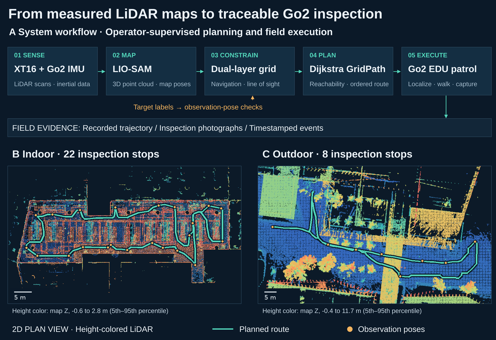
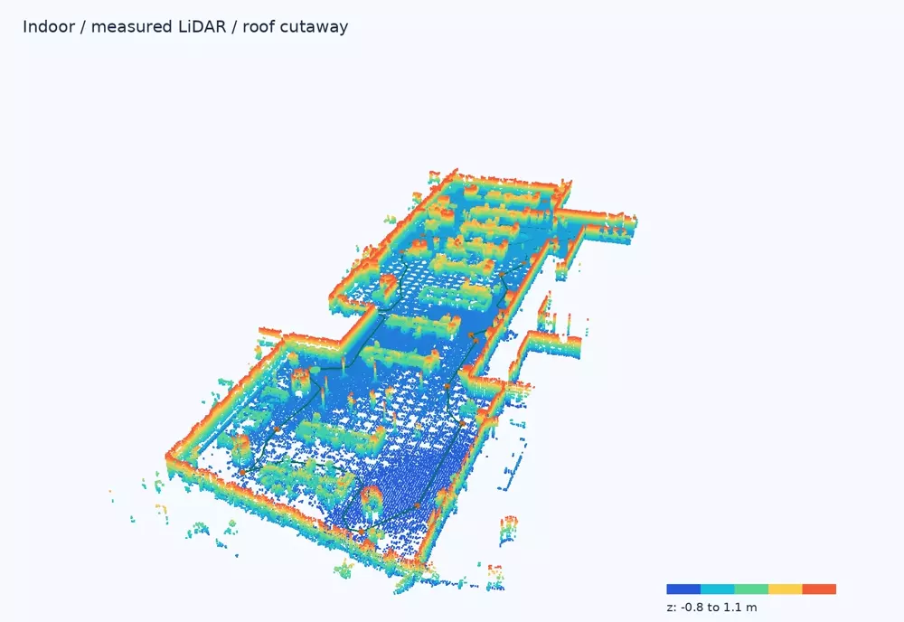
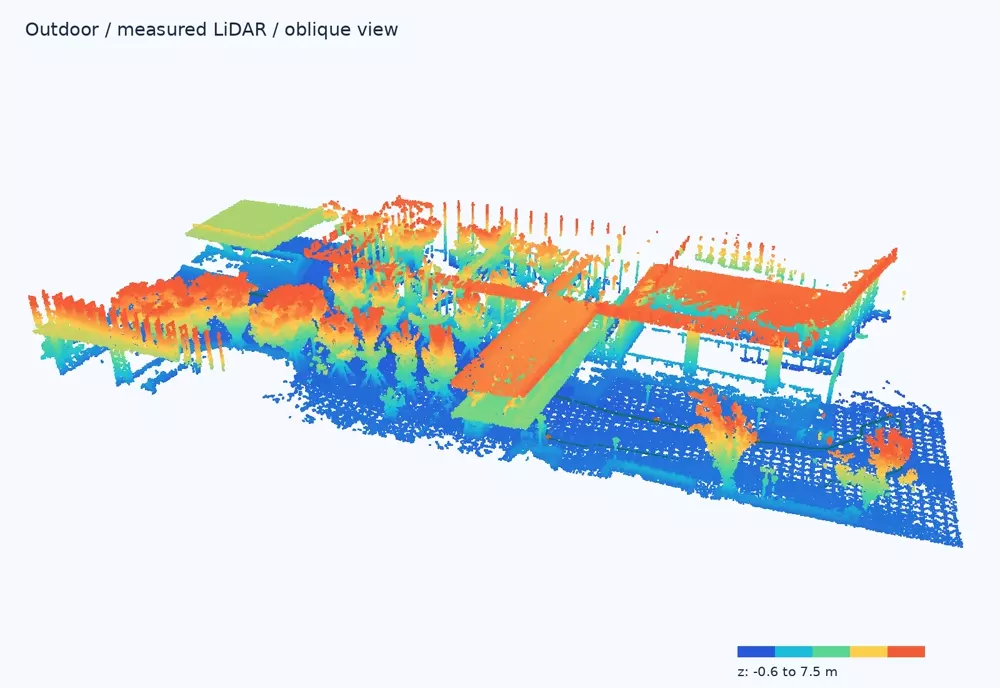
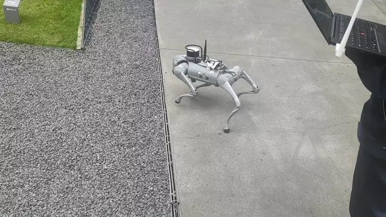
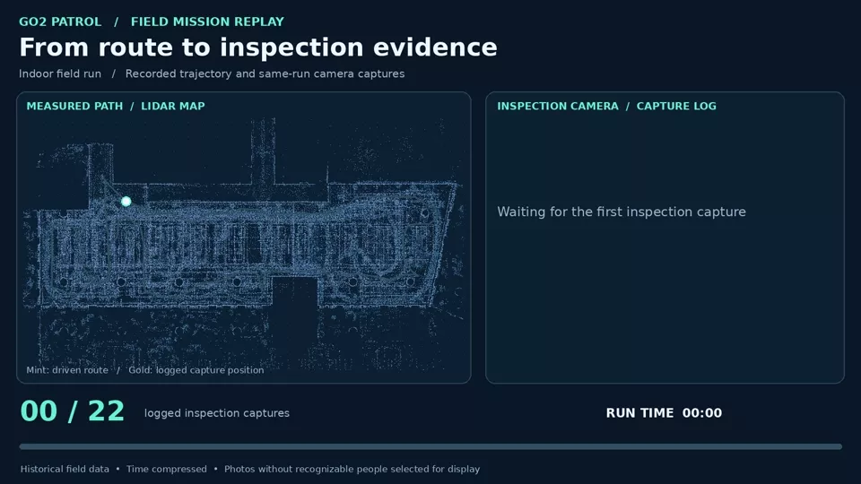
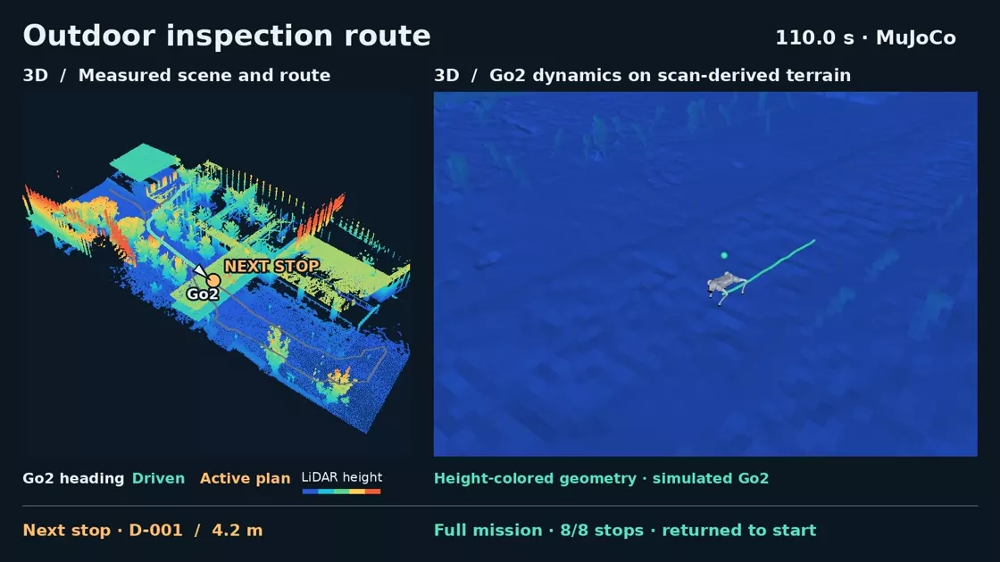

# Go2 Patrol: From LiDAR–Inertial Mapping to Rule-Based Quadruped Inspection

A supervised inspection workflow for Unitree Go2 EDU: measured LIO-SAM maps, dual-layer geometric constraints and Dijkstra routes, linked to recorded trajectories and inspection photographs.


[](LICENSE)

## Overview

[](docs/system.md)

### Measured scenes in 3D

| Indoor roof cutaway | Outdoor environment |
| :---: | :---: |
| [](assets/indoor-scene-tour.mp4?raw=1) | [](assets/outdoor-scene-tour.mp4?raw=1) |

Height encodes measured map Z in metres. The orbit reveals the original scan geometry. The indoor display removes overhead points to expose interior walls and room layout. [Rendering methods and comparisons](docs/visual-comparison.md)

## XT16 mapping calibration

A matched 1,040-second indoor replay used the same LIO-SAM code and sensor recording. Updating the IMU axis rotation and roll/pitch fusion weight together reduced the estimated trajectory's **vertical span from 5.97 m to 0.89 m**. Both side views share the same axes. [Calibration method and evidence](docs/mapping.md)


The XT16 frame adaptation rotates Go2 IMU vectors from frame I into LiDAR frame L. The archived A/B changes the roll/pitch fusion weight from 0.01 to 0.15 alongside that rotation.

```math
\mathbf{v}_{L}
=\begin{bmatrix}
0 & 1 & 0 \\
-1 & 0 & 0 \\
0 & 0 & 1
\end{bmatrix}\mathbf{v}_{I},
\qquad \Delta z = \max_i z_i-\min_i z_i
```

## Navigation and line-of-sight layers

[](docs/mapping.md)

The planner estimates local ground from the point cloud and the nearest recorded mapping pose. Near the trajectory, a height ceiling filters canopy and overhead returns before the ground percentile is computed. Here $g_k=z_k-0.485$ m and $d_c$ is the horizontal distance from cell $c$ to that pose.

```math
\begin{aligned}
z_{\max}(c) &= g_k+d_c\tan(25^\circ)+0.16+0.05,\\
\hat g_c &= Q_{0.15}\bigl(\{z_i : z_i\le z_{\max}(c),\ i\in c\}\bigr).
\end{aligned}
```

In each 0.15 m cell, the two masks count returns in different bands above $\hat g_c$. The navigation layer checks body clearance. The line-of-sight layer screens candidate viewing poses for higher obstructions.

```math
\begin{aligned}
n_c(a,b) &= \sum_{i\in c}\mathbf{1}(a\lt z_i-\hat g_c\lt b),\\
N(c) &= \mathbf{1}(n_c(0.16,0.6296)\ge 2),\\
V(c) &= \mathbf{1}(n_c(0.90,2.20)\ge 2).
\end{aligned}
```

## Datasets

Download the [indoor and outdoor datasets](datasets/). Each includes a metric XYZ point cloud, planned route and ordered observation poses in a shared local frame.

## Field demos

| Indoor inspection | Outdoor gravel crossing |
| :---: | :---: |
| [](assets/field-exterior-indoor.mp4?raw=1) | [](assets/field-exterior-outdoor.mp4?raw=1) |

### Indoor mission replay · 22/22 captures

[](assets/indoor-mission-replay.mp4?raw=1)

## SLAM-map physical simulation

The enlarged 3D view places the Go2 mesh at its archived MuJoCo pose inside the measured LiDAR scene, at 1× speed. Height-colored surface elements reveal nearby geometry; a fixed scene inset locates the robot and next stop on the full route. The mint trail marks recent simulated motion. These display elements do not replace the archived collision terrain. [Display methods and comparisons](docs/visual-comparison.md)

**Outdoor · 8/8 inspection stops and return**

[](assets/slam-outdoor-route.mp4?raw=1)

**Indoor · 4/22 inspection stops before a contact-triggered safety stop**

[](assets/slam-indoor-route.mp4?raw=1)

## Navigation comparison

[](docs/navigation-comparison.md)

## Run the route audit

```bash
python -m pip install -r requirements.txt
python -m examples.offline_audit
```

## Acknowledgments

- [Unitree Robotics](https://support.unitree.com/home/zh/developer/about_Go2) for the official Go2 developer documentation.
- [Hesai Technology](https://www.hesaitech.com/product_downloads/xt32-16/) for the official XT16 LiDAR documentation.
- [University of Electronic Science and Technology of China (UESTC)](https://en.uestc.edu.cn/) for providing equipment and resource support.

## License

The [LICENSE](LICENSE) file describes rights and attribution for the code, documentation, datasets and media. It does not grant a general right to modify or redistribute those materials. See the notice for dataset evaluation and reuse terms. Third-party components remain governed by their respective upstream licenses.
