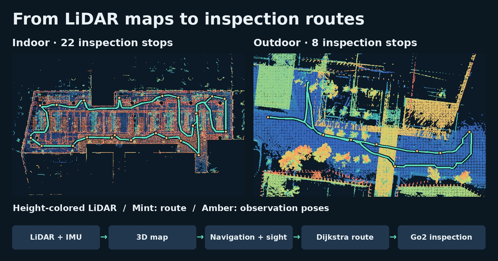
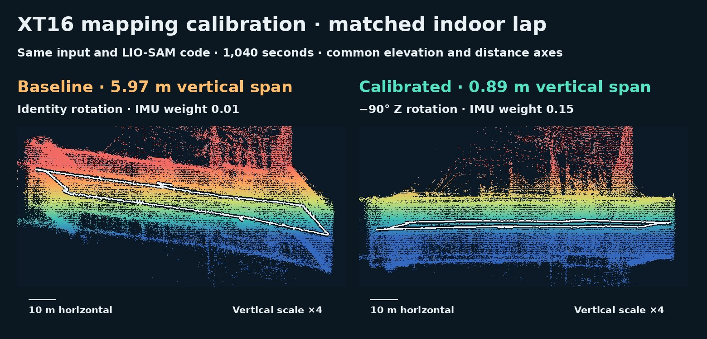
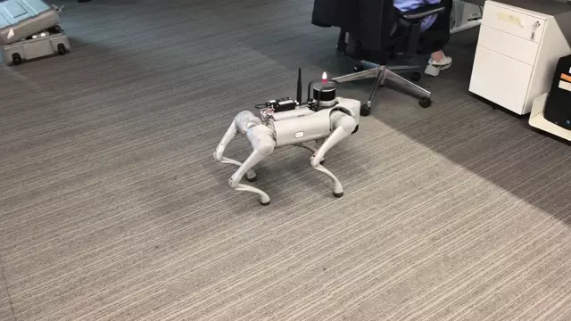
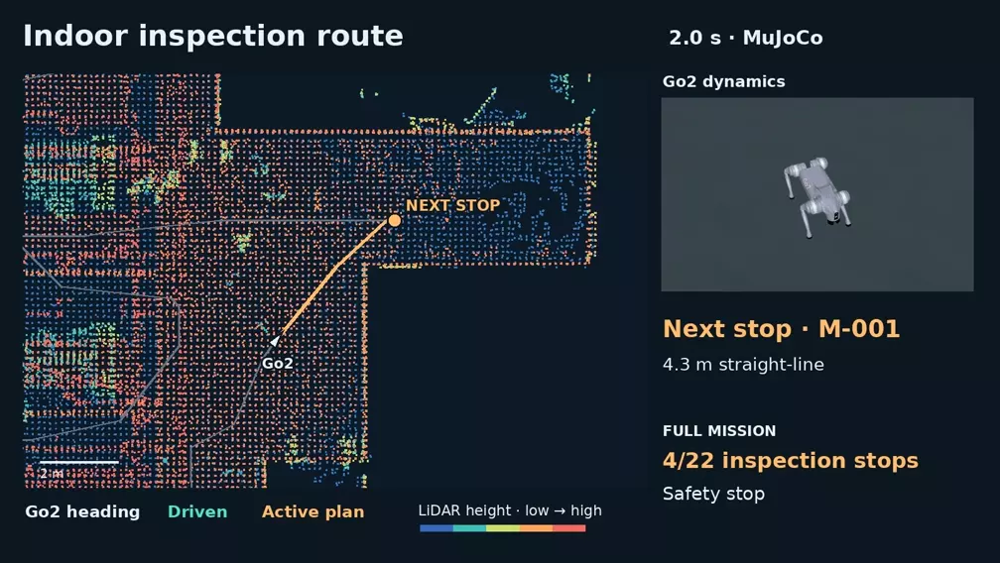

# Go2 Patrol

Rule-based LiDAR SLAM inspection with Unitree Go2 EDU. The system plans routes with Dijkstra and links each field run to its trajectory and inspection photos.


[](LICENSE)

## Overview

[](docs/system.md)

## XT16 mapping calibration

A matched 1,040-second indoor replay used the same LIO-SAM code and sensor recording. Updating the IMU axis rotation and roll/pitch fusion weight together reduced the estimated trajectory's **vertical span from 5.97 m to 0.89 m**. Both side views share the same axes. [Calibration method and evidence](docs/mapping.md)



The XT16 frame adaptation rotates Go2 IMU vectors into LiDAR axes. The archived A/B changes the roll/pitch fusion weight from 0.01 to 0.15 alongside that rotation.

$$
mathbf v_{mathrm{LiDAR}}=
egin{bmatrix}0&1&0\-1&0&0\0&0&1end{bmatrix}mathbf v_{mathrm{IMU}},
qquad
Delta z=max_i z_i-min_i z_i.
$$

## Navigation and line-of-sight layers

The planner estimates local ground from the point cloud and the nearest recorded mapping pose. Near the trajectory, a height ceiling filters canopy and overhead returns before the ground percentile is computed. Here $g_k=z_k-0.485$ m and $d_c$ is the horizontal distance from cell $c$ to that pose.

$$
z_{max}(c)=g_k+d_c	an(25^circ)+0.16+0.05,qquad
hat g_c=Q_{0.15}igl({z_i:z_ile z_{max}(c),,iin c}igr).
$$

In each 0.15 m cell, the two masks count returns in different bands above $hat g_c$. The navigation layer checks body clearance. The line-of-sight layer screens candidate viewing poses for higher obstructions.

$$
N(c)=mathbf 1[n_c(0.16,,0.6296)ge 2],
qquad
V(c)=mathbf 1[n_c(0.90,,2.20)ge 2],
qquad
n_c(a,b)=#{iin c:a<z_i-hat g_c<b}.
$$

## Datasets

Download the [indoor and outdoor datasets](datasets/). Each includes a metric XYZ point cloud, planned route and ordered observation poses in a shared local frame.

## Field demos

| Indoor inspection | Outdoor gravel crossing |
| :---: | :---: |
| [](assets/field-exterior-indoor.mp4?raw=1) | [](assets/field-exterior-outdoor.mp4?raw=1) |

### Indoor mission replay · 22/22 captures

[](assets/indoor-mission-replay.mp4?raw=1)

## SLAM-map physical simulation

The Go2 follows the original inspection routes on LiDAR-derived terrain in MuJoCo. The fixed maps show Go2 heading, driven path, active route and the next observation pose. The insets show the same moments at 1× speed.

**Outdoor · 8/8 inspection stops and return**

[](assets/slam-outdoor-route.mp4?raw=1)

**Indoor · 4/22 inspection stops before a contact-triggered safety stop**

[](assets/slam-indoor-route.mp4?raw=1)

## Navigation comparison

[](docs/navigation-comparison.md)

## Run the route audit

```bash
python -m pip install -r requirements.txt
python -m examples.offline_audit
```
