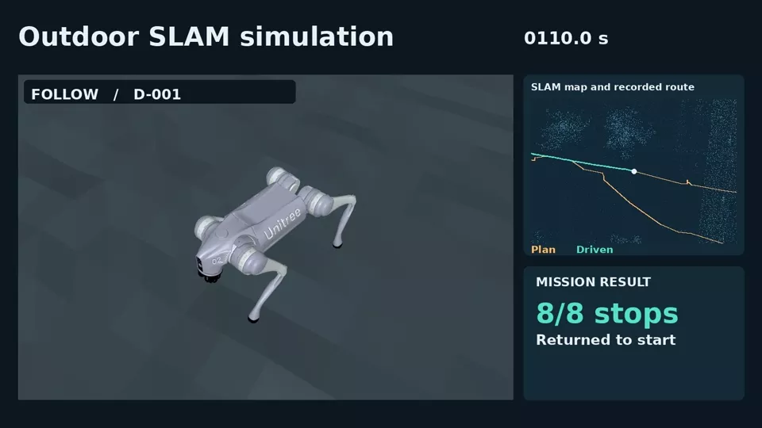
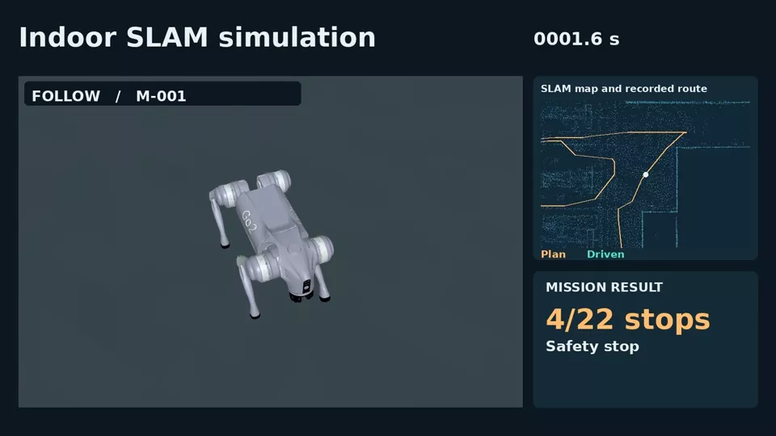

# Go2 Patrol

Rule-based LiDAR SLAM inspection with Unitree Go2 EDU. The system plans routes with Dijkstra and links each field run to its trajectory and inspection photos.

## Field demos

| Indoor inspection | Outdoor gravel crossing |
| :---: | :---: |
| [](assets/field-exterior-indoor.mp4?raw=1) | [](assets/field-exterior-outdoor.mp4?raw=1) |

### Indoor mission replay · 22/22 captures

[](https://github.com/walmfml88886666/go2-rule-based-inspection/releases/download/v0.3.0/indoor-mission-replay.mp4)

## SLAM-map physical simulation

The Go2 follows the original inspection routes on LiDAR-derived terrain in MuJoCo. The previews show continuous walking at 1× speed.

**Outdoor · 8/8 inspection stops and return**

[](assets/slam-outdoor-walk.mp4?raw=1)

**Indoor · 4/22 inspection stops before a contact-triggered safety stop**

[](assets/slam-indoor-walk.mp4?raw=1)

## System architecture

[](docs/system.md)

## Navigation comparison

[](docs/navigation-comparison.md)

## Run the route audit

```bash
python -m pip install -r requirements.txt
python -m examples.offline_audit
```
