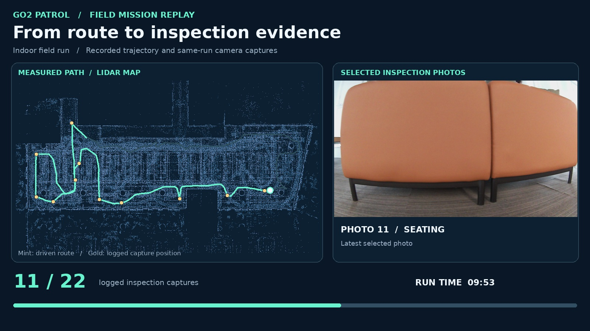

# Field media

## Indoor mission replay

The replay combines the recorded path, the LiDAR corner cloud, and selected photographs from one indoor mission. The archive includes 10,195 pose samples over about 17 minutes and 22 inspection photo events. Each inspection photo's filename and byte size match its event record. Eight photos are displayed in the replay and appear at their logged capture times. The result is a 24-second, time-compressed reconstruction.

## First-person recordings and maps

The first-person clips come from separate field runs. The point-cloud figures project historical corner clouds and stored mission plans onto the map plane. They show planned routes. The public images omit raw point clouds and machine configuration.

| Asset | Source | Presentation |
| --- | --- | --- |
| [Go2 EDU hardware](../assets/robot.jpg) | Project hardware photograph | Original 3840 × 2160 JPEG |
| [Indoor recording](https://github.com/walmfml88886666/go2-rule-based-inspection/releases/download/v0.2.0/indoor-field.mp4) | Indoor first-person field recording | 12-second excerpt from 00:21, 1280 × 720 |
| [Outdoor daylight recording](https://github.com/walmfml88886666/go2-rule-based-inspection/releases/download/v0.2.0/outdoor-day-field.mp4) | Outdoor first-person daylight recording | 12-second excerpt from 03:05, 1280 × 720 |
| [Outdoor night recording](https://github.com/walmfml88886666/go2-rule-based-inspection/releases/download/v0.2.0/outdoor-night-field.mp4) | Outdoor first-person night recording | 12-second excerpt from 00:22, 1280 × 720 |
| [Indoor map](../assets/indoor-field-map.png) | Indoor LiDAR corner cloud and stored mission plan | 22 planned observation stops |
| [Outdoor map](../assets/outdoor-field-map.png) | Outdoor LiDAR corner cloud and stored mission plan | 8 planned observation stops |

The camera clips are silent and have no added motion or speed effects. Preview loops use the first few seconds of each clip. Map colors distinguish the planned route, marked targets, and the start/return position. For identity and integrity checks, see [asset provenance](asset-provenance.json). The [planning demonstrations](simulation.md) use synthetic layouts.

[Back to the README](../README.md)

## Third-person field footage

The README pairs two independent excerpts from the acceptance archive under FYX. The indoor excerpt starts 2 s into the target-approach recording. The outdoor excerpt starts 6 s into the daylight gravel-and-slope recording. Both are nine seconds at recorded speed with audio removed. The recorded mission replay covers the full timeline through 22 logged captures, displaying eight selected photos.

[Indoor target approach](../assets/field-exterior-indoor.mp4?raw=1) · [Outdoor gravel and slope](../assets/field-exterior-outdoor.mp4?raw=1)
