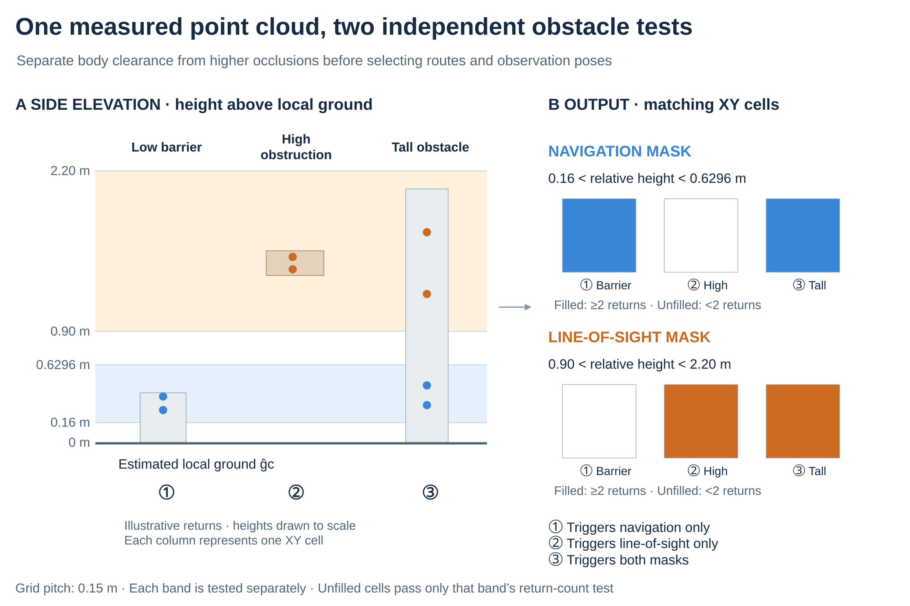
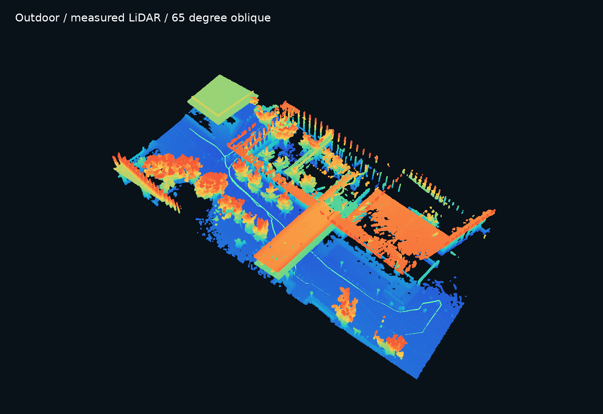
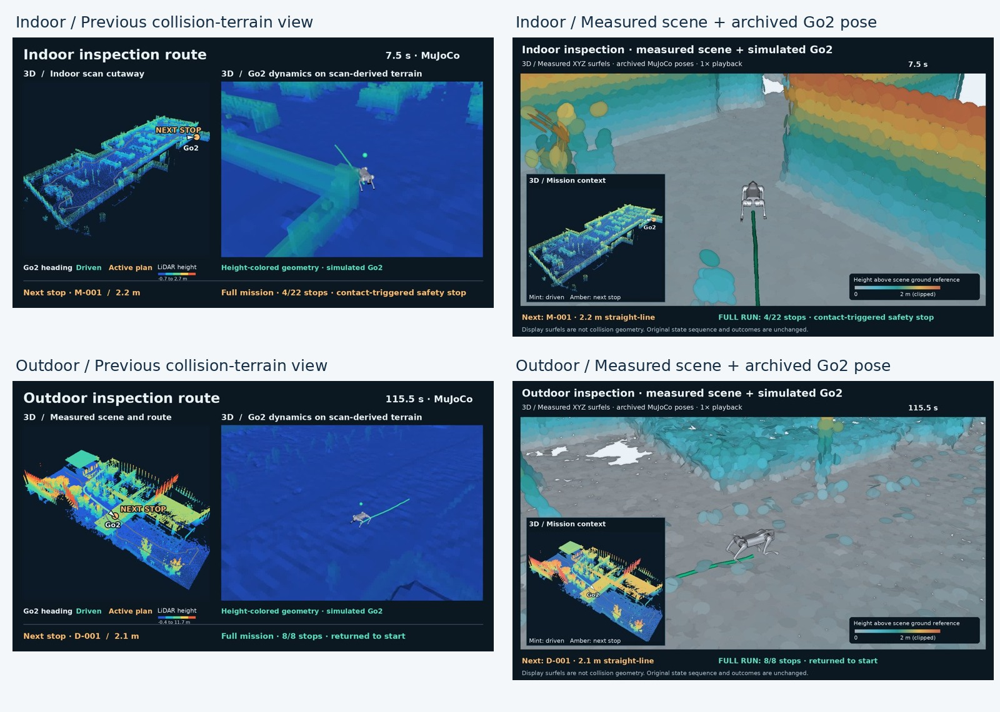

# 3D rendering methods and comparisons

## System architecture


[Editable draw.io master](system-overview.drawio) · [SVG export](../assets/system-overview.svg)

## Planning layers



[Editable draw.io master](navigation-sight-principle.drawio) · [SVG export](../assets/navigation-sight-layers.svg)

Three illustrative columns show a low barrier, a higher obstruction and a tall obstacle. Each represents one XY cell. Both height bands use strict endpoints and an independent threshold of at least two returns. An unfilled cell passes that band’s count test only; it does not establish traversability or visibility by itself.

## Camera-angle comparison

The original point positions are height-colored and viewed from oblique cameras. Left and right columns compare 35° and 65° camera elevations. These are visualization candidates from the original localization maps.


## Selected scene views

The overview uses a common dark canvas, numbered workflow stages and paired map panels. The principle diagram uses a side elevation and corresponding cell outputs, with heights drawn to scale. The measured scene views below use 35° oblique cameras, display-only sparse-cell filtering and per-scene height colors.




## Rendering backends


| Backend / preset | What is displayed | Visual assessment |
| --- | --- | --- |
| OpenGL point rendering | Measured XYZ returns with height colors | Preserves scan detail and works well in the orbit previews |
| VTK point splats | Display-filtered returns rendered as small Gaussian footprints | Softer edges, but light backgrounds reduce contrast |
| VTK eye-dome lighting | Depth shading applied to the point splats | Stronger depth boundaries, with reduced color clarity in this preset |
| VTK Gaussian surface | An isosurface derived from point-density splatting | More continuous silhouettes, but sampling can create or close gaps |
| MuJoCo | Existing robot states on archived collision geometry | Shows the robot dynamics and recent simulated path |

These are visual comparisons of rendering presets, including different display sampling. The VTK density surface is a visualization reconstruction. Physics replay uses the archived collision model and state arrays.

The 3D scene tours retain cells with at least two returns in a 0.18 m voxel for display. The indoor cutaway removes points above the scene's fifth-percentile Z plus 1.9 m. Each scene is colored using its retained second to ninety-eighth percentile Z, with a numeric color legend. Planned XY paths and observation points are drawn as reference overlays on a horizontal plane.

## Enlarged patrol view

The main viewport now combines the original finite XYZ measurements with the Go2 visual meshes posed from each saved MuJoCo state. A fixed oblique mission-context inset shows the same timestamp, driven trace and next observation pose. The excerpts remain indoor 2–13 s and outdoor 110–121 s, at 1×; the full recorded outcomes remain 4/22 before a contact-triggered stop and 8/8 with return.

The local display uses tangent disks (surfels), centered on unchanged measured samples. PCA normals use 16 neighbors; disk radius is 0.105 m with 12 sides. GPU glyph rendering adds no semantic labels or phototextures. Eye-dome depth shading is blended at 35% with the base render to keep depth boundaries visible without overwhelming the height colors. The neutral floor, cyan, teal, amber and red encode height, not object category.

A fixed eighth-percentile Z of the excerpt's selected neighborhood supplies a **display ground reference**, distinct from the planner's per-cell ground estimate. The color range is 0–2 m above that reference, clipped outside the range. The indoor display retains Z between that reference minus 0.3 m and plus 2.0 m; outdoor retains through plus 3.5 m. These cutaways and footprints can obscure gaps and fine geometry; they are not a surface survey or a replacement collision model. The robot's silver display material improves contrast. Kinematics are evaluated with `mj_forward`; the renderer never calls `mj_step` or changes recorded states.

During selection, original-point spheres, several Gaussian-density scales, tangent disks, and Hoppe surface reconstruction were compared at multiple camera angles. Large density footprints exaggerated walls and ground; implicit reconstruction added unsupported surfaces. Tangent disks retained the scan positions and made nearby geometry easier to read. The archived collision model remains authoritative for the recorded physical simulation.



## Figure layout references

The multi-panel composition was informed by the official [FDM](https://github.com/leggedrobotics/fdm), [elevation_mapping_cupy](https://github.com/leggedrobotics/elevation_mapping_cupy), [grid_map](https://github.com/ANYbotics/grid_map) and [LIO-SAM](https://github.com/TixiaoShan/LIO-SAM) repositories. Their images, implementations and scientific claims are not copied into these figures. The diagrams describe this project's existing workflow and thresholds.

## Reproduce the editable figures

`python -m tools.render_inspection_figures` generates the two `.drawio` masters and embedded map panels from the published datasets (NumPy and Pillow required). Open the masters in [draw.io Desktop](https://github.com/jgraph/drawio-desktop) or export them using its CLI, for example:

```bash
drawio --export --format png --scale 1.5 --output assets/system-overview.png docs/system-overview.drawio
drawio --export --format svg --output assets/system-overview.svg docs/system-overview.drawio
```

Use `docs/navigation-sight-principle.drawio` for the second figure. The exported PNG is used in the README; SVG and editable sources are available for enlargement and future edits.

## Reproduce the enlarged patrol view

Optional rendering dependencies used here: MuJoCo 3.10.0, VTK 9.7.2, NumPy 2.5.5 and Pillow 13.0.0, with EGL and H.264-capable FFmpeg. The original verified input archive and archived state arrays are required; the public metric dataset export alone does not contain the full simulation state and robot assets.

```bash
python -m examples.render_measured_patrol --inputs /path/to/verified-inputs \
  --robot-xml /path/to/unitree-go2.xml --run /path/to/archived-indoor-run \
  --scene indoor --output /path/to/render-output --ffmpeg /path/to/ffmpeg
```

Use `--preview` for six stills and `--scene outdoor` with its matching archived run for the second scene. Output is written separately from the source run.

## Reproduce the scene tours

With the original verified input archive and optional MuJoCo/PyOpenGL/Pillow dependencies available:

```bash
python -m examples.render_scene_tour --inputs /path/to/verified-inputs --output /path/to/output --ffmpeg /path/to/ffmpeg
```
