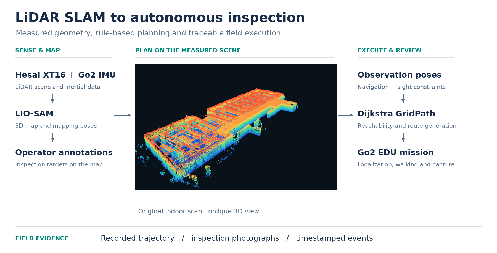

# Rendering review

## System architecture

## Planning layers

## Measured 3D environment candidates

The original point positions are height-colored and viewed from oblique cameras. Left and right columns compare 35° and 65° camera elevations. These are visualization candidates from the original localization maps.

