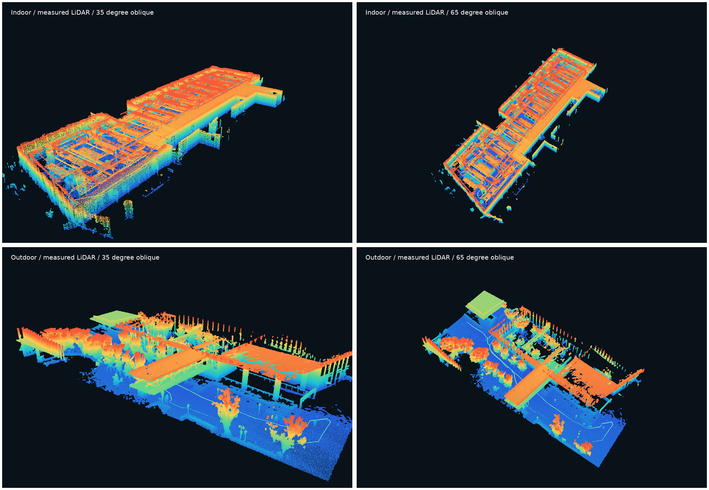
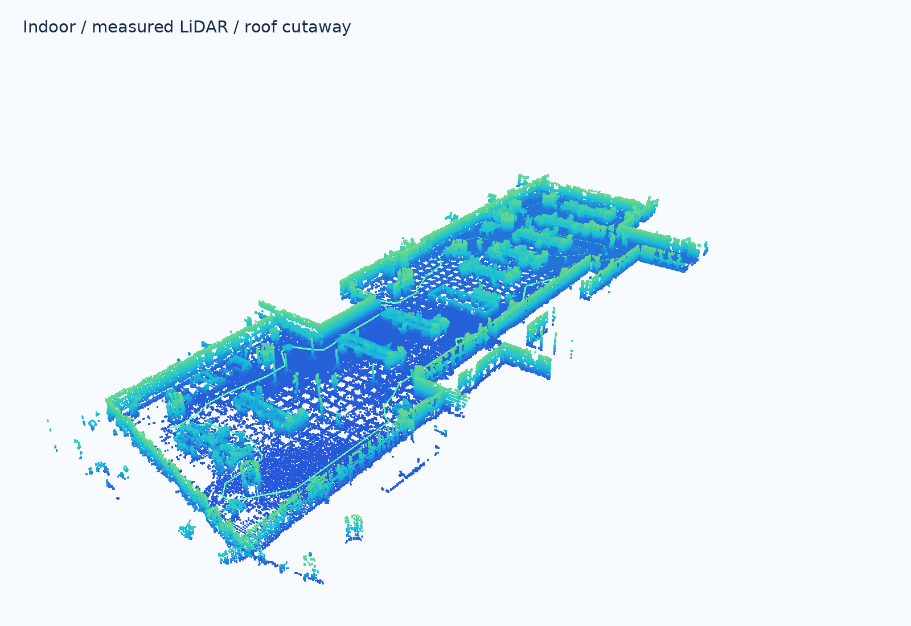

# Rendering review

## System architecture

## Planning layers

## Measured 3D environment candidates

The original point positions are height-colored and viewed from oblique cameras. Left and right columns compare 35° and 65° camera elevations. These are visualization candidates from the original localization maps.

## Second round

The architecture uses a common light background and a roof cutaway. The two layers have more separation, physical obstacle examples, and an explicit grid pitch. The measured scene views below use 35° oblique cameras, display-only sparse-cell filtering and per-scene height colors.

